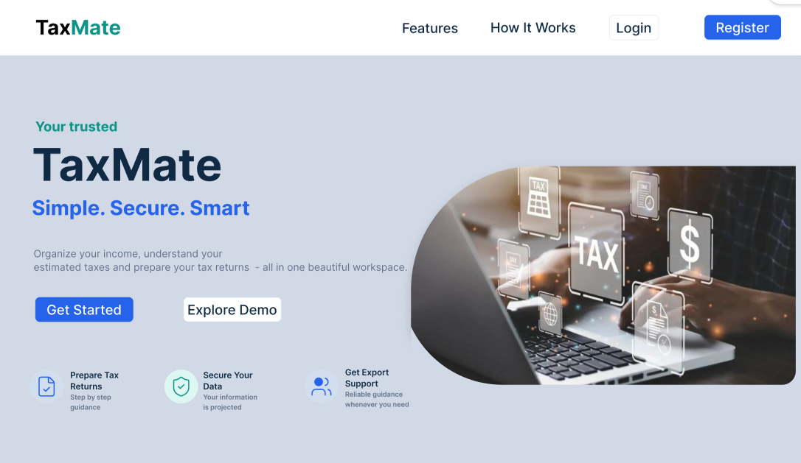

# 🧾 TaxMate

### Smart Tax Management and Advisory Platform for Sri Lanka

**Simplifying tax management through digital innovation.**

TaxMate is a proposed digital platform designed to simplify tax-related activities for individuals in Sri Lanka. It aims to provide tax calculations, taxpayer profile management, financial record management, and access to professional tax advisors through a centralized, user-friendly system.

---

## 🖥️ TaxMate System

The following image illustrates the proposed landing page design of the TaxMate system.

*Figure 1: Proposed TaxMate Landing Page Design*
---

## 🎯 Project Objectives

- Simplify personal tax management.
- Provide assessment-year-based tax calculations.
- Support taxpayer profile and tax record management.
- Connect taxpayers with approved tax advisors.
- Provide administrator functionality for user management, advisor approvals, and tax rule management.
- Protect sensitive taxpayer information through secure access controls.

## ✨ Proposed Key Features

- **Taxpayer Dashboard:** View tax-related summaries and important information.
- **Tax Calculation:** Estimate tax liabilities using applicable tax rules.
- **Tax Records:** Organize relevant financial and tax information.
- **Tax Advisory:** Discover and assign approved tax advisors.
- **Administration:** Manage users, tax advisors, and tax rule versions.

## 👥 User Roles

| Role | Description |
|---|---|
| Taxpayer | Manages profiles, tax calculations, records, and advisor assignments. |
| Tax Advisor | Manages professional profiles and accesses authorized taxpayer information. |
| Administrator | Manages accounts, advisor approvals, and tax rules. |

## 🚀 Development Status

TaxMate is currently in its initial development phase. System designs, project setup, and implementation activities are being completed incrementally.

## 🎓 Academic Project

TaxMate is developed as a five-member academic software engineering project. GitHub is used for version control, collaboration, and tracking individual contributions.

---

**TaxMate — Your Digital Tax Companion.**